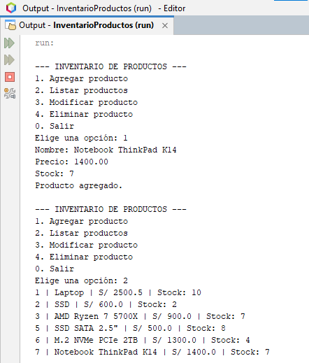

# Inventario de Productos (Java + MySQL)

Aplicación de consola en Java para gestionar el inventario de una tienda de componentes de computadora. Permite agregar, listar, modificar y eliminar productos, y guarda todos los datos en una base de datos MySQL.

## Funcionalidades

- Agregar productos (nombre, precio y stock)
- Listar todos los productos
- Modificar un producto existente
- Eliminar un producto por ID
- Validación de los datos ingresados
- Los datos persisten en MySQL

## Tecnologías

- Java 25
- MySQL 8
- JDBC (MySQL Connector/J)
- Patrón DAO
- Apache NetBeans
- Git y GitHub

## Estructura del proyecto

```
src/inventarioproductos/
├── InventarioProductos.java   # Menú principal
├── Producto.java              # Modelo de datos
├── ProductoDAO.java           # Acceso a datos (CRUD)
└── Conexion.java              # Conexión a MySQL
```

## Requisitos

- JDK 17 o superior
- MySQL Server 8 y MySQL Workbench
- MySQL Connector/J, descargado desde dev.mysql.com y agregado en *Libraries* del proyecto

## Cómo ejecutarlo

1. Clona el repositorio.
2. Ejecuta el script `database.sql` en MySQL Workbench para crear la base de datos y la tabla.
3. Copia `config.properties.example` y renómbralo a `config.properties`.
4. Edita `config.properties` con tu usuario y contraseña de MySQL.
5. Abre el proyecto en NetBeans, agrega el conector en *Libraries* y ejecuta `InventarioProductos.java`.

## Captura



## Autora

Carol Figueroa Díaz - [LinkedIn](https://www.linkedin.com/in/carol-fd-100b95431/)